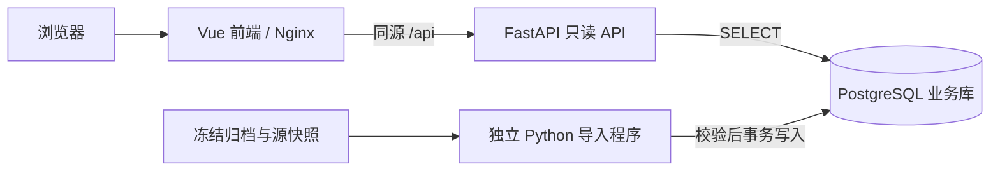

# 埋点分析管理：FastAPI + Vue

管理台入口：<http://127.0.0.1:8090/>。Vue 3 + TypeScript + Element Plus 负责页面，FastAPI + Pydantic + Uvicorn 提供只读 JSON API。数据库、冻结缓存、分析与导入程序沿用第一阶段实现。



## 功能与当前数据

支持按批次、账号和 UTC 日查询：Top10、分母与原因、前日环比、7 日中位数基线、质量与覆盖、主候选／合并线索、筛选与排除原因、问题假设、证据定位和完整单账号上下文。筛选条件保存在 URL，旧批次／用户链接可直接打开及刷新。指标详情通过抽屉展示；候选池／排除记录按需分页读取；事实 ID 可自动切换证据分页、滚动定位并高亮。

- 快照 `prod-us-release-20261029T080615Z`，源 SHA256 `264e8c81124307c93112a437156fb32d159d2e48346d214f439c86e0261ea31d`。
- 原批次 `f51f9e659e0fa818954570ccfcfd766906f0c0f0f5c79399f76242652bba2e67`：3 份日报（2026-10-25～27 UTC）、20 账号、52 条关联线索、1178 行账号埋点聚合。
- 请求日 10 月 28 日仍为 `WAITING_EXPORT`，计算／归档为 `SUCCEEDED`；默认展示最近可用日报。
- 451 条候选观察、650 条排除记录完整保留；不把观察行数当作去重账号数。
- 沿用原阈值、范围、版本和原 JSON；20 账号仍为 `SELECTED_PREVIEW`，实例目标 `UNRESOLVED`。待验证假设不表示已确认根因，聚合不能恢复逐事件顺序。
- 本轮只迁移展示与查询。**不查询 BigQuery，不创建采集任务，不发送推送，不调用模型，不修改 Kestra 流程。** 新归档仍需显式运行离线导入 CLI，没有启用自动入库。

## 运行与开发

已有本机数据库和缓存时，直接构建启动即可，**无需再次建库或导入**：

```bash
docker compose \
  --env-file /Volumes/SanDisk-CaseSensitive/code/log/analytics-governance/.scratch/management/local.env \
  -f /Volumes/SanDisk-CaseSensitive/code/log/analytics-governance/management/compose.yaml \
  up -d --build api web
```

`web` 仅发布 `127.0.0.1:8090`，提供前端文件及 `/api` 代理；`api` 监听容器内 8091，不向宿主发布端口。前端只连接专用 ui 网络，不持有数据库凭据；API 同时连接 ui 和既有 PostgreSQL 网络。前后端镜像、构建及发布独立，Nginx 通过 Docker DNS 重新解析 API。容器非 root、根文件系统只读，Nginx 临时文件仅写 `/tmp`。

前端开发需要 Node 22.12+（Docker 构建固定 Node 22.23.3）：

```bash
npm --prefix /Volumes/SanDisk-CaseSensitive/code/log/analytics-governance/management/frontend ci --ignore-scripts
npm --prefix /Volumes/SanDisk-CaseSensitive/code/log/analytics-governance/management/frontend run dev
npm --prefix /Volumes/SanDisk-CaseSensitive/code/log/analytics-governance/management/frontend run build
```

开发地址默认 `127.0.0.1:5173`，Vite 将 `/api` 代理到已启动的本机 8090；无需开放 CORS。`build` 先执行 `vue-tsc`，再生成前端产物。依赖锁定在 `package-lock.json` 与 `requirements.lock`，API 容器安装后者。前端仅注册用到的 Element Plus 组件，页面路由按需加载。

首次安装才运行 `setup_local.py`，已有库不重复初始化：

```bash
python3 /Volumes/SanDisk-CaseSensitive/code/log/analytics-governance/management/setup_local.py \
  --env-file /Volumes/SanDisk-CaseSensitive/code/log/analytics-governance/.scratch/management/local.env \
  --archive /Volumes/SanDisk-CaseSensitive/code/log/.scratch/analytics-triggered-log-collection/kestra-evidence-20261029 \
  --snapshot /Volumes/SanDisk-CaseSensitive/code/log/analytics-governance/.scratch/bigquery-replay/prod-us-release-20261029T080615Z
```

需要显式导入已有归档时继续使用原 CLI，可重复执行且不重新查询 BigQuery：

```bash
docker compose \
  --env-file /Volumes/SanDisk-CaseSensitive/code/log/analytics-governance/.scratch/management/local.env \
  -f /Volumes/SanDisk-CaseSensitive/code/log/analytics-governance/management/compose.yaml \
  run --rm import python import_cached.py --archive /archive --snapshot /snapshot \
  --execution-id 65vaHa6WJc5D1zehJXWqQO
```

env 文件保持 0600、不提交。源和归档只挂载给显式导入容器，且为只读；API 不挂载源缓存、服务号密钥或导入凭据。停止管理台使用同一 compose 命令的 `stop api web`，不删除业务数据或 PostgreSQL 卷；不提供自动 DROP 数据脚本。

## API 合同与页面路由

所有业务接口仅 GET；scope 来自服务端配置，不接受前端切换。API 数据主体沿用原归档 snake_case 字段，避免改变证据身份。OpenAPI JSON：<http://127.0.0.1:8090/api/openapi.json>，不依赖外部 Swagger 脚本。

| API | 返回内容 |
| --- | --- |
| `/api/v1/meta` | 固定 scope、冻结模式、只读与禁派单标记 |
| `/api/v1/runs` | 批次及日报／账号／线索计数，可按精确账号过滤 |
| `/api/v1/runs/{run_id}` | 来源版本、候选漏斗、统计日、策略和 Kestra 执行引用 |
| `/api/v1/runs/{run_id}/reports/{day}` | 原样日报，包含 Top10、全事件、质量、窗口及比较 |
| `/api/v1/runs/{run_id}/users` | 选中账号、主候选及线索／事实数 |
| `/api/v1/runs/{run_id}/candidates` | 完整候选池，保持原选样／未选中原因 |
| `/api/v1/runs/{run_id}/exclusions` | 全部排除观察，保持原排除码 |
| `/api/v1/users/{account_id}` | 用户的归档批次列表 |
| `/api/v1/users/{account_id}/contexts/{run_id}` | 该用户该批次完整上下文与主候选 |
| `/api/healthz`、`/healthz` | 数据库只读连接健康检查 |

列表参数 `limit`（1～100，默认100）、`offset`（非负，默认0），返回 `{items,total,limit,offset}`。批次、候选账号、候选池和排除列表可传 `account` 精确过滤；用户历史通过路径指定账号。分页顺序稳定，不改变原候选池顺序。计数分别聚合，避免多表连接重复计数。

错误统一为 `{error:{code,message}}`：参数非法／重复／额外字段400，当前 scope 记录不存在404，写方法405，数据库不可用503，内部故障500；返回通用说明，不暴露 SQL 或证据正文。OpenAPI 与实际400校验策略一致。

页面保留 `/`、`/runs/{run_id}?day=...&account=...`、`/users?account=...` 和 `/users/{account_id}?run=...`。浏览器直接访问这些路径返回 SPA 入口，资源状态由 API 反馈；因此自动化调用应访问 `/api/v1`，不要把 SPA 的 HTTP 200 当作业务记录存在。空用户明确说明“没有已归档候选上下文”，不推断该用户没有异常。

## 存储与访问边界

复用 `log-backend-local-postgres-1` 及原卷，业务库 `analytics_management`、schema `analytics`，不修改 Kestra 内部表或新增数据库端口。

| 表 | 主要内容 |
| --- | --- |
| `telemetry_runs` | 批次、scope、请求日、双轴状态、完整分析 JSONB、来源／规则／归档摘要 |
| `daily_reports` | 按批次／UTC 日固定的全事件、Top10、质量、环比／基线 |
| `diagnostic_contexts` | 按批次／账号定位的完整上下文、主候选及预览／目标状态 |
| `telemetry_findings` | 已选账号的52条线索及原事实引用、比较和检查方向 |
| `run_executions` | 可追加、去重的 Kestra 执行引用 |

run_id、context_id、候选 key、来源摘要不变。日报修订 ID 为 `SHA256([run_id, statistical_day])`，线索修订 ID 为 `SHA256([run_id, candidate_key])`，仍按批次显式查看，不新增跨批次当前指针。

原导入程序继续校验快照字节／行数／次数／覆盖、run/context 身份、账号归属、原始时间与次数、线索引用及排除集合，并在一个事务中写入。相同 run 的事务锁保证并发复用；内容冲突拒绝，异常完整回滚。

`analytics_owner` 不可登录；独立 CLI 的 `analytics_importer` 仅 SELECT/INSERT；API 的 `analytics_reader` 仅 SELECT 并使用只读事务。固定 scope 与账号／批次绑定全部在服务端查询；用户详情不会读取其他账号上下文。API 不执行分析任务、不持有写入能力。

所有数据响应 no-store，页面文本按 Vue 默认方式转义，脚本／接口只允许同源，关闭含账号的请求路径日志。仅为 Element Plus 的布局样式允许 inline style，不启用 inline script 或 eval。

仍为单机操作者使用，**未增加登录、团队权限或公网访问**；同机其他进程／使用者也能访问本机端口。共享前需接受控认证授权。服务端保留／删除与备份恢复政策仍待确认，不把手机7天／30天期限套用于此库。

## 核验与实现位置

没有新增单元测试。迁移核验包括：前端类型检查／生产构建、全部3日报与20上下文逐项等于原归档、451候选与650排除的分页重组和原顺序相等、双轴状态／空结果／参数／scope隔离／写方法拒绝／数据库503、业务表行数和内容摘要迁移前后一致，以及真实浏览器的日期／用户／抽屉／证据跨页定位／分页／窄屏操作。既有12项Python检查和10文件149事件Schema校验通过。

- `api.py`／`api_models.py`：只读路由、输入输出模型、统一错误；`db.py`：沿用现有数据库连接。
- `frontend/src/views`：批次列表、日报批次、用户详情；`components`：比较、事实、归档分页等展示组件。
- `frontend/src/types.ts`：页面消费的数据契约；`api.ts`：只读请求与取消旧查询，防止快速切换显示过期结果。
- `frontend/nginx.conf`、两个 Dockerfile 和 compose：独立构建与同源部署。
- `schema.sql`、`setup_local.py`、`import_cached.py`：保留原业务数据模型与离线导入。

依据：[FastAPI 响应模型](https://fastapi.tiangolo.com/tutorial/response-model/)、[查询参数模型](https://fastapi.tiangolo.com/tutorial/query-param-models/)、[Vue Router](https://router.vuejs.org/guide/essentials/dynamic-matching.html)、[Element Plus Table](https://element-plus.org/en-US/component/table.html)。
